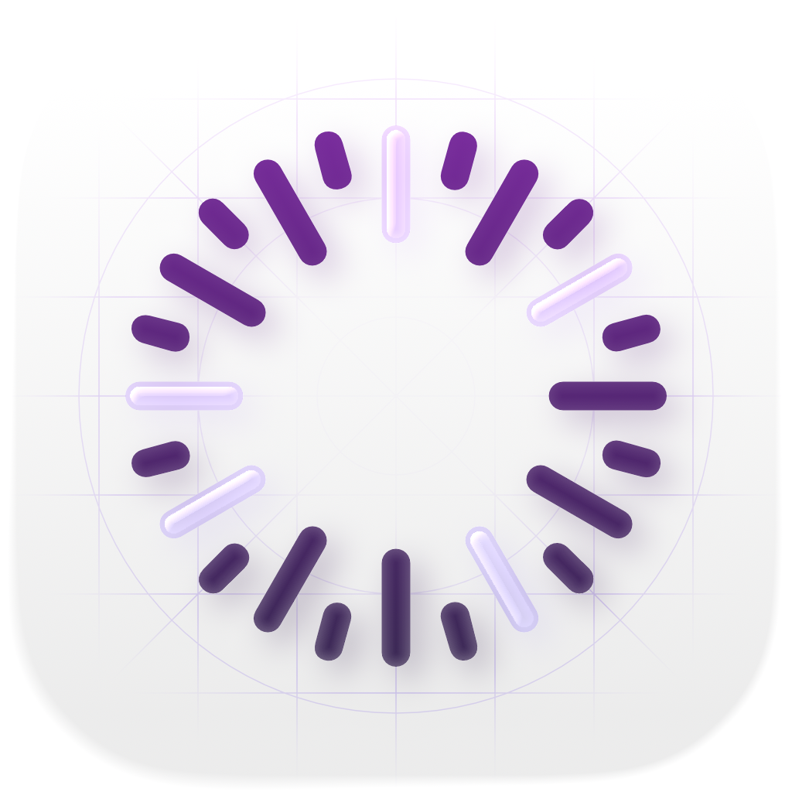

<blockquote>
  <details>
    <summary>
      <code>あ ←→ A</code>
    </summary>
    <!--Head-->
    &emsp;&ensp;<sub><b>Elapse Recorder</b> 支持以下语言。</sub>
    <br />
    <!--Body-->
    <br />
    &emsp;&ensp;<a href="/README.md">English</a>
    <br />
    &emsp;&ensp;简体中文
  </details>
</blockquote>

### <div><!--Empty Lines--><br /><br /></div>

# <p align="center"><picture><source media="(prefers-color-scheme: dark)" srcset="/ElapseRecorder/Icon/Elapse%20Recorder-iOS-Dark-1024x1024@1x.png?raw=true" /></picture><br />Elapse Recorder</p><br />

###### <p align="center">记录工作，回看过程。</p>

### <div><!--Empty Lines--><br /><br /></div>

Elapse Recorder是一款原生macOS菜单栏工具——它可以在你工作时定期截取特定应用的窗口，将你的绘画、编程、3D建模等漫长而零散的工作过程自动整理成**过程延时视频。**

设置你关心的应用和监视规则后，你无须再次干预，Elapse Recorder会按计划在后台运行，安静地捕获你的工作过程。工作结束后，你可以在资料库中浏览并导出已捕获的内容。

## 功能特性

- **白名单驱动捕获：**将指定应用加入白名单；目标应用运行时，Elapse Recorder会自动开始捕获，并在其退出后自动停止。启动工具时已经运行的应用也会立即被识别。
- **逐窗口截图：**ScreenCaptureKit会枚举目标应用的所有可捕获窗口，并分别记录；持久的逐窗口捕获流避免在每个间隔重新创建捕获会话。最小化、离屏或尺寸为零的窗口会被跳过。
- **会话与稳定窗口编号：**应用的一次连续运行对应一个*会话。*窗口在会话内获得稳定的编号，窗口标题的变化也会被记录。
- **灵活调度：**每个应用可以独立设置捕获间隔，并可切换自动或手动捕获模式。
- **持久且高效的存储：**捕获内容先写入HEIC/PNG暂存区，再封装为经过校验的HEVC视频分段；受监控应用位于前台时会暂停该压缩过程，避免编解码工作与前台输入争抢资源。录制目录无法写入时会暂停录制，存储检查通过后自动恢复。
- **资料库：**你可以按应用→会话→窗口的顺序浏览捕获内容、查看逐窗口**时间线图**或应用级平铺图库，并通过“快速查看”打开独立图片或视频分段中的帧。
- **延时视频导出：**以流式方式将任意独立帧或视频分段帧导出为原始分辨率的**H.264或HEVC**视频（`.mp4` / `.mov`），可调整帧率并选择在相邻帧之间加入交叉淡化插帧。

## 系统要求

- macOS 15.7或更高版本
- **屏幕录制权限**（系统设置→隐私与安全性→屏幕与系统音频录制）

## 安装与运行

1. 从[GitHub Releases](https://github.com/deltaiota/ElapseRecorder/releases/latest)页面下载最新ZIP文件。
2. 解压`Elapse Recorder.app`并将其移动到`/Applications`。
3. 首次启动时，右键单击应用并选择**打开。**如果macOS仍然阻止启动，请在系统设置→隐私与安全性中允许Elapse Recorder运行，然后再次打开。

> [!NOTE]
>
> 官方版本使用免费Apple Development证书签名，并通过Sparkle EdDSA验证，但未经过公证。macOS仍可能要求你通过Finder或隐私与安全性批准首次启动。

## 构建

```sh
# 构建
xcodebuild build -project ElapseRecorder.xcodeproj -scheme ElapseRecorder \
  -destination 'platform=macOS,arch=arm64' \
  -skipMacroValidation -skipPackagePluginValidation

# 测试
xcodebuild test -project ElapseRecorder.xcodeproj -scheme ElapseRecorder \
  -destination 'platform=macOS,arch=arm64' \
  -only-testing:ElapseRecorderTests \
  -skipMacroValidation -skipPackagePluginValidation -quiet
```

你也可以直接在Xcode中打开`ElapseRecorder.xcodeproj`。

## 架构

Elapse Recorder使用**SwiftUI**和**[The Composable Architecture](https://github.com/pointfreeco/swift-composable-architecture)。**后端以**GRDB/SQLite**提供带索引的元数据存储，并使用持久图片暂存区与经过AVFoundation校验的HEVC视频分段。ScreenCaptureKit、NSWorkspace事件、文件系统和媒体编码等实时系统API均封装在依赖客户端之后。

- `Backend/`：录制服务、单调时钟调度器、GRDB数据库、存储协调器、恢复、维护和流式资料库
- `Domain/`：值类型以及捕获与窗口过滤规则
- `Dependencies/`：TCA依赖客户端及实时系统实现
- `Persistence/`：GRDB持久化操作与数据库模型
- `Features/`：TCA reducer
- `Views/`：SwiftUI视图

项目使用了[The Composable Architecture](https://github.com/pointfreeco/swift-composable-architecture)、[Defaults](https://github.com/sindresorhus/Defaults)、[TranslateKit](https://github.com/FlineDev/TranslateKit)、[SFSafeSymbols](https://github.com/SFSafeSymbols/SFSafeSymbols)、[LogOutLoud](https://github.com/Aeastr/LogOutLoud)和[LaunchAtLogin-Modern](https://github.com/sindresorhus/LaunchAtLogin-Modern)。
