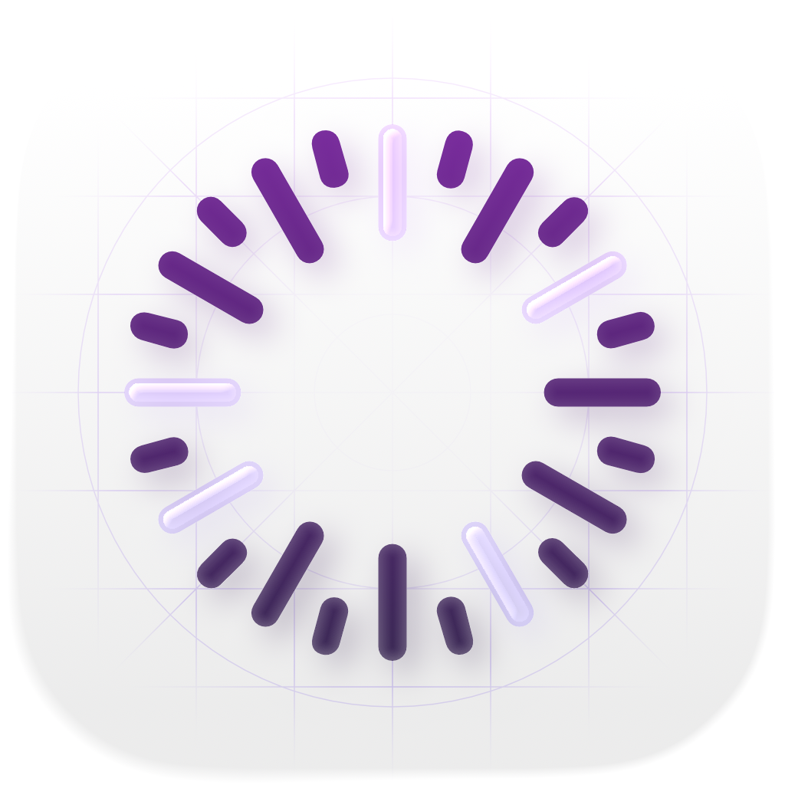

<blockquote>
  <details>
    <summary>
      <code>あ ←→ A</code>
    </summary>
    <!--Head-->
    &emsp;&ensp;<sub><b>Elapse Recorder</b> supports the following languages.</sub>
    <br />
    <!--Body-->
    <br />
    &emsp;&ensp;English
    <br />
    &emsp;&ensp;<a href="/Docs/简体中文.md">简体中文</a>
  </details>
</blockquote>

### <div><!--Empty Lines--><br /><br /></div>

# <p align="center"><picture><source media="(prefers-color-scheme: dark)" srcset="/ElapseRecorder/Icon/Elapse%20Recorder-iOS-Dark-1024x1024@1x.png?raw=true" /></picture><br />Elapse Recorder</p><br />

###### <p align="center">Capture your work. Replay your process.</p>

### <div><!--Empty Lines--><br /><br /></div>

Elapse Recorder is a native macOS menu bar utility that periodically captures selected application windows while you work, automatically turning long, fragmented drawing, coding, and 3D-modeling sessions into **process timelapses.**

After choosing the applications and monitoring rules you care about, no further intervention is required. Elapse Recorder runs quietly in the background on your schedule. When your work is done, browse the captured material in the library and export it.

## Features

- **Whitelist-driven capture:** Add selected applications to a whitelist. Elapse Recorder starts capturing while a target application is running and stops after it quits. Applications already running when Elapse Recorder starts are detected immediately.
- **Per-window screenshots:** ScreenCaptureKit enumerates the target application's capturable windows and records each separately. Persistent per-window streams avoid rebuilding capture sessions on every interval. Minimized, off-screen, and zero-size windows are skipped.
- **Sessions and stable window numbering:** One continuous application run forms a _session._ Windows receive stable numbers within that session, and window-title changes are recorded.
- **Flexible scheduling:** Configure a capture interval for each application and choose automatic or manual capture mode.
- **Durable, efficient storage:** Captures first enter a HEIC/PNG spool. Background HEVC compaction paces itself against CPU usage and pauses when a monitored application is frontmost. Only verified segments replace spool images. Recording pauses if the capture folder becomes unwritable and resumes when storage checks pass.
- **Library:** Browse captures by application → session → window, inspect per-window **timeline graphs** or a flat application gallery, and open standalone images or video-backed frames with Quick Look.
- **Timelapse video export:** Stream any combination of standalone and video-backed frames into source-resolution **H.264 or HEVC video** (`.mp4` / `.mov`), with configurable frame rate and optional crossfade interpolation between adjacent frames.

## Requirements

- macOS 15.7 or later
- **Screen Recording permission** (System Settings → Privacy & Security → Screen & System Audio Recording)

## Install & Run

1. Download the latest ZIP from the [GitHub Releases](https://github.com/deltaiota/ElapseRecorder/releases/latest) page.
2. Extract `Elapse Recorder.app` and move it to `/Applications`.
3. On first launch, right-click the app and choose **Open.** If macOS still blocks it, approve Elapse Recorder under System Settings → Privacy & Security and open it again.

> [!NOTE]
>
> Official releases are signed with a free Apple Development certificate and authenticated by Sparkle EdDSA, but they are not notarized. macOS may still require first-launch approval through Finder or Privacy & Security.

## Building

```sh
# Build
xcodebuild build -project ElapseRecorder.xcodeproj -scheme ElapseRecorder \
  -destination 'platform=macOS,arch=arm64' \
  -skipMacroValidation -skipPackagePluginValidation

# Test
xcodebuild test -project ElapseRecorder.xcodeproj -scheme ElapseRecorder \
  -destination 'platform=macOS,arch=arm64' \
  -only-testing:ElapseRecorderTests \
  -skipMacroValidation -skipPackagePluginValidation -quiet
```

You can also open `ElapseRecorder.xcodeproj` directly in Xcode.

## Architecture

Elapse Recorder is built with **SwiftUI** and **[The Composable Architecture](https://github.com/pointfreeco/swift-composable-architecture).** Its backend uses **GRDB/SQLite** for indexed metadata, a durable image spool, and AVFoundation-verified HEVC video segments. Live system APIs—including ScreenCaptureKit, NSWorkspace events, the filesystem, and media encoding—remain behind dependency clients.

- `Backend/`: recording service, monotonic scheduler, GRDB database, storage coordinator, recovery, maintenance, and streaming library
- `Domain/`: value types and capture/window-filtering rules
- `Dependencies/`: TCA dependency clients and live system implementations
- `Persistence/`: GRDB persistence operations and database models
- `Features/`: TCA reducers
- `Views/`: SwiftUI views

Built with [The Composable Architecture](https://github.com/pointfreeco/swift-composable-architecture), [Defaults](https://github.com/sindresorhus/Defaults), [TranslateKit](https://github.com/FlineDev/TranslateKit), [SFSafeSymbols](https://github.com/SFSafeSymbols/SFSafeSymbols), [LogOutLoud](https://github.com/Aeastr/LogOutLoud), and [LaunchAtLogin-Modern](https://github.com/sindresorhus/LaunchAtLogin-Modern).
